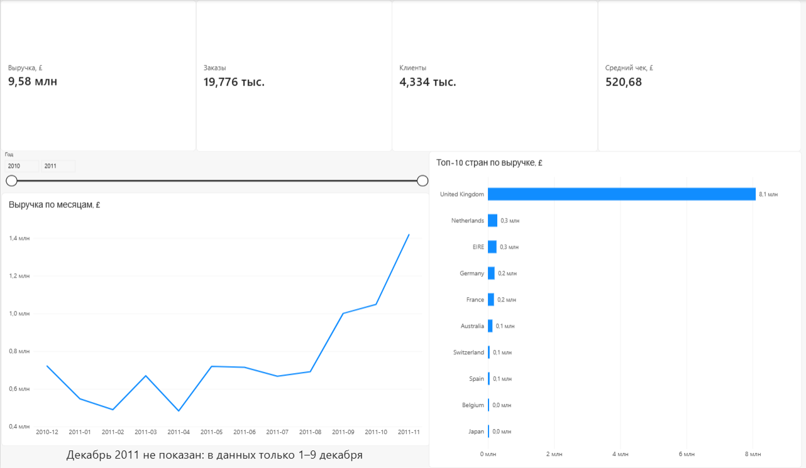
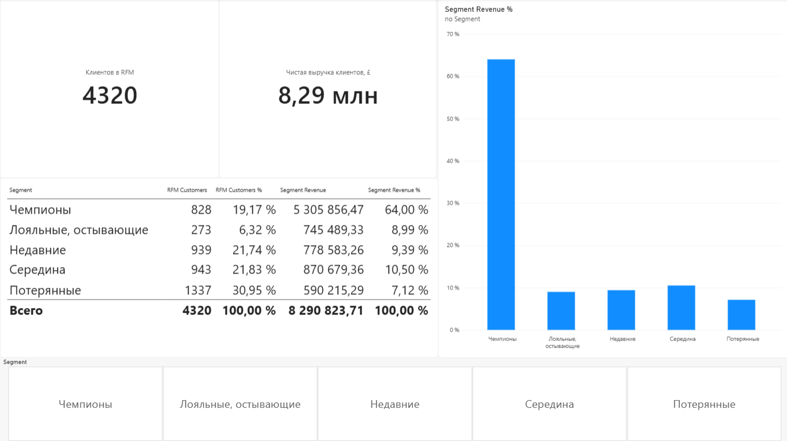
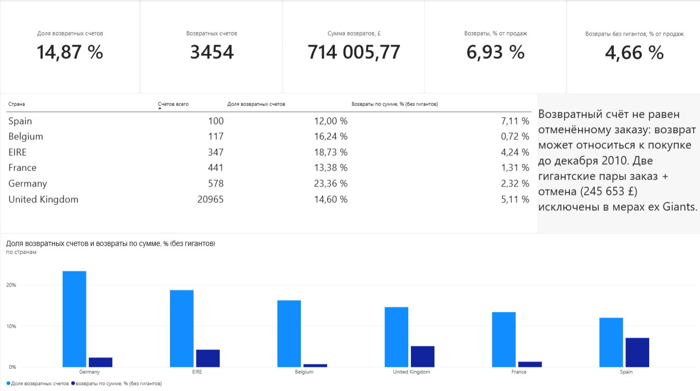

# E-Commerce Analysis: от сырых данных до инсайтов

> Open to Junior Data Analyst / BI Analyst roles (remote or Kazakhstan).

## Summary (English)

An end-to-end portfolio project analyzing ~536K transactions from a UK online retailer (Kaggle E-Commerce Data, Dec 2010 - Dec 2011). Data was cleaned in Python (pandas), explored in SQL (SQLite: CTEs, window functions, conditional aggregation), segmented with RFM, cross-checked in Google Sheets, and visualized in a 3-page Power BI dashboard (Power Query, DAX).

**Key findings**
- The UK accounts for 84% of revenue (£8.09M of £9.58M), and the share is stable month to month.
- Revenue peaks in November (~£1.42M); December 2011 is incomplete and excluded from trends.
- 20% of customers (6+ orders) generate 68% of revenue. RFM "Champions" are 19% of customers but 64% of revenue.
- Returns are 14.9% of invoices but only 6.9% of sales value.

**Method notes:** results were validated across SQL, Google Sheets and Power BI (totals matched exactly). Errors found along the way (returns counted as orders, gross instead of net revenue in RFM) are documented in the "Исправленные ошибки" section.

*Full write-up in Russian below.*


Учебный портфолио-проект дата-аналитика. Полный цикл: очистка данных в Python, исследование в SQL, RFM-сегментация, независимая проверка в Google Sheets и интерактивный дашборд в Power BI.

**Данные:** [E-Commerce Data (Kaggle)](https://www.kaggle.com/datasets/carrie1/ecommerce-data), транзакции британского интернет-магазина с 2010-12-01 по 2011-12-09. Последний месяц (декабрь 2011) неполный.

**Инструменты:** Python (pandas), SQLite, SQL (CTE, оконные функции, условная агрегация), Google Sheets (сводные таблицы), Power BI (Power Query, DAX).



---

## Главные выводы

1. **Бизнес сильно зависит от Великобритании.** UK даёт 84,44% выручки (8,09 млн £ из 9,58 млн £). Доля стабильна по месяцам (77–91%), то есть это структурная особенность, а не временный эффект.
2. **Выраженная сезонность.** Выручка растёт к осени и достигает пика в ноябре (около 1,42 млн £), тогда как в начале года держится около 0,5 млн £.
3. **Небольшая группа клиентов даёт основную выручку.** 20% клиентов с 6+ покупками приносят 68% выручки. По RFM «Чемпионы» (19% клиентов) дают 64% выручки, а «Потерянные» (31% клиентов) только 7%.
4. **Возвраты: часто, но понемногу.** Возвратные счета составляют 14,87% всех счетов, но только 6,93% продаж по сумме. Германия лидирует по доле возвратных счетов (23,36%), но по сумме возвраты там минимальны (2,32% против 5,11% в UK).

---

## Вопросы и результаты

### 1. Топ-страны и концентрация выручки

| Страна | Чистая выручка, £ | Доля |
|---|---|---|
| United Kingdom | 8 091 948,20 | 84,44% |
| Netherlands | 283 479,54 | 2,96% |
| EIRE | 259 663,46 | 2,71% |
| Germany | 200 808,40 | 2,10% |
| France | 182 163,39 | 1,90% |

Netherlands на втором месте при всего 96 счетах: это крупные оптовые заказы.

### 2. Сезонность

Пик сентябрь–ноябрь, в ноябре около 1,42 млн £. Декабрь 2011 на графиках не показан: в данных только 1–9 декабря, и спад в этом месяце был бы ложным.

### 3. Retention (по числу заказов)

Анализ по 4 320 клиентам (возвратные счета не считаются заказами).

| Сегмент | Клиентов | Доля клиентов | Доля выручки |
|---|---|---|---|
| 1 покупка | 1 493 | 34,56% | 6,50% |
| 2–5 покупок | 1 962 | 45,42% | 25,44% |
| 6+ покупок | 865 | 20,02% | 68,06% |

### 4. RFM-сегментация

| Сегмент | Клиентов | Доля клиентов | Чистая выручка, £ | Доля выручки |
|---|---|---|---|---|
| Чемпионы | 828 | 19,17% | 5 305 856,47 | 64,00% |
| Лояльные, остывающие | 273 | 6,32% | 745 489,33 | 8,99% |
| Недавние | 939 | 21,74% | 778 583,26 | 9,39% |
| Середина | 943 | 21,83% | 870 679,36 | 10,50% |
| Потерянные | 1 337 | 30,95% | 590 215,29 | 7,12% |

**Как считаются оценки (R, F, M от 1 до 5):**
- **R (давность):** квинтили по числу дней с последней покупки, самые недавние получают 5.
- **F (частота):** число покупок. 1 → 1, 2 → 2, 3–4 → 3, 5–7 → 4, 8+ → 5. Пороги заданы явно, чтобы результат воспроизводился при пересчёте.
- **M (деньги):** квинтили чистой выручки клиента (покупки минус возвраты).

**Правила сегментов (применяются по порядку):**
1. Чемпионы: R ≥ 4 и F ≥ 4
2. Лояльные, остывающие: F ≥ 4
3. Недавние: R ≥ 4
4. Потерянные: R ≤ 2 и F ≤ 2
5. Середина: все остальные

### 5. Возвраты

| Показатель | Значение |
|---|---|
| Всего счетов | 23 230 |
| Возвратных счетов | 3 454 (14,87%) |
| Валовые продажи | 10 296 944,57 £ |
| Возвраты | 714 005,77 £ (6,93%) |
| Возвраты без двух гигантских пар «заказ + отмена» | 468 352,57 £ (4,66%) |

Две гигантские пары (74 215 и 80 995 единиц, отменены через 12–16 минут) дают 245 653,20 £, то есть 34,4% всей суммы возвратов.

| Страна | Счетов | Доля возвратных счетов | Доля возвратов по сумме (без гигантов) |
|---|---|---|---|
| Germany | 578 | 23,36% | 2,32% |
| EIRE | 347 | 18,73% | 4,24% |
| Belgium | 117 | 16,24% | 0,72% |
| United Kingdom | 20 965 | 14,60% | 5,11% |
| France | 441 | 13,38% | 1,31% |
| Spain | 100 | 12,00% | 7,11% |

Возвраты в Германии распределены между многими клиентами: топ-1 клиент даёт 13% возвратных счетов, это не проблема одного покупателя.

---

## Очистка данных

Из исходной таблицы удалены:
- служебные коды товаров (`D`, `POST`, `M`, `BANK CHARGES`, `C2`, `DOT`, `CRUK`, `PADS`, `S`);
- служебные записи в описании (`check`, `damages`, `found`, `adjustment`, `thrown away`, `amazon` и др.);
- строки с нулевой или отрицательной ценой, а также нулевая цена без описания.

Добавлены столбцы `Revenue` (количество × цена) и `IsReturn` (номер счёта начинается с `C`). После очистки в таблице `transactions` 536 529 строк. Около 25% строк не имеют `CustomerID`, поэтому они исключены из клиентской аналитики (retention, RFM) и остаются в общих итогах по выручке.

---

## Проверка результатов

| Проверка | Результат |
|---|---|
| Выручка по странам: SQL и сводная таблица Google Sheets | совпала до копейки (итог 9 582 938,80 £, доля UK 84,44%) |
| Карточки Power BI и SQL | совпали: выручка 9 582 938,80, заказов 19 776, средний чек 520,68 |
| Выручка RFM-сегментов и retention-сегментов (SQL) | обе суммы равны 8 290 823,71 £ |

Число клиентов в дашборде: 4 334 (хотя бы одна покупка) против 4 320 в RFM. Разница в 14 клиентов с нулевой или отрицательной чистой выручкой, их исключили из RFM и retention.

### Исправленные ошибки

Эти пункты оставлены в README намеренно, чтобы показать ход работы:
- Первая версия retention считала возвратные счета заказами (получилось 30,42 / 45,12 / 24,46% клиентов). После исправления: 34,56 / 45,42 / 20,02%. Вывод про концентрацию выручки сохранился, но цифры изменились.
- В первой версии RFM параметр Monetary считался как валовая выручка, из-за чего клиент с отменённым заказом на 77 183,60 £ выглядел топовым. Теперь используется чистая выручка (покупки минус возвраты).
- Для процентов в Power BI формула с `ALL(rfm[Segment])` давала 100% после настройки сортировки; исправлена на `ALL(rfm)`.

---

## Ограничения

- Мы измеряем долю **возвратных счетов**, а не процент отменённых заказов: возврат может относиться к покупке до декабря 2010.
- В данных нет причин возвратов, поэтому гипотезы о причинах (качество, доставка) не проверялись.
- По Испании выборка мала (100 счетов), по Нидерландам (96 счетов) возвраты не анализировались.
- RFM-пороги рассчитаны по данным этого периода и не переносятся на другие данные без пересчёта.
- Последний месяц неполный, поэтому его выручку нельзя сравнивать с остальными.

---

## Дашборд Power BI

Файл: `powerbi/ecommerce_dashboard.pbix`. Три страницы:

1. **Обзор:** выручка, заказы, клиенты, средний чек, выручка по месяцам, топ-10 стран, срез по году.
2. **Клиенты:** RFM-сегменты (число клиентов, доля клиентов, выручка, доля выручки), срез по сегменту.
3. **Возвраты:** доля возвратных счетов и доля возвратов по сумме по странам, показатели без гигантских пар.




---

## Структура проекта

```
ecommerce-analysis/
├── data/
│   └── rfm_segments.csv  # результат RFM-сегментации (исходный CSV с Kaggle в репозиторий не входит)
├── sql/
│   └── exploratory_queries.sql
├── notebook.ipynb        # очистка и RFM в Python
├── powerbi/
│   └── ecommerce_dashboard.pbix
├── images/               # скриншоты дашборда
└── README.md
```

## Как воспроизвести

1. Скачайте `data.csv` с Kaggle и положите в `data/`.
2. Запустите `notebook.ipynb`: очистка данных, запись в `ecommerce.db` (таблицы `transactions` и `rfm`).
3. Выполните запросы из `sql/exploratory_queries.sql` (например, в DB Browser for SQLite).
4. Выгрузите таблицы в CSV, откройте `ecommerce_dashboard.pbix` и обновите источники.

## Автор

**Rakhim Yanshenlo**

[LinkedIn](https://www.linkedin.com/in/rakhim-yanshenlo-7b2184444/)
